# Antigravity Android 层架构（`app/`）

模块 `app/` 是 **Antigravity v2.4+（Android ARM64，Bionic + Glibc 用户空间，targetSdk 28 / minSdk 24）** 环境的原生 Android 宿主（Native Host Shell）。

宿主负责启动与监管 Go 核心 `language_server`、提供基于 Chromium WebView 的受保护 UI 容器、本地系统功能 HTTP 网关（System Gateway Server），以及与 Android 平台的集成（通知、省电、剪贴板、存储、Shizuku/rish）。

---

## 1. 组件总体架构

```mermaid
graph TD
    subgraph UI_Layer ["表现层 (UI Layer)"]
        LDA["LauncherDarkActivity / LauncherLightActivity"] --> MA["MainActivity"]
        MA --> SC["SplashController (NativeSplashDotsView / Lazy WebView)"]
        MA --> WVH["WebViewHost (Chromium WebView)"]
        WVH --> AWVC["AgyWebViewClient (OAuth 与资源拦截器)"]
        WVH --> AWCC["AgyWebChromeClient (控制台、文件、弹窗)"]
        WVH --> LAS["LocalAssetServer (进程内分发 files/web/)"]
        WVH --> AHI["AppHtmlInjector (注入 __APP_CONFIG__ 与令牌)"]
    end

    subgraph Bridge_Layer ["桥接与安全"]
        MA --> AB["AndroidBridge (JavascriptInterface 'Android')"]
        AB --> UB["UiBridge (onUiReady、致命错误、桌面模式)"]
        AB --> TB["ThemeBridge (主题同步)"]
        AB --> EB["EngineBridge (核心状态与参数)"]
        AB --> ECJ["EngineConfigJson (配置序列化)"]
    end

    subgraph Core_Layer ["后台服务与监管 (Core Layer)"]
        CSS["CoreServerService (前台服务 + WakeLock)"]
        CSS --> CPS["CoreProcessSupervisor (核心生命周期管理)"]
        CPS --> CL["CoreLauncher (阶段 1 安装与进程启动)"]
        CPS --> CRP["CoreReadyProbe (探测 https://127.0.0.1:port)"]
        CPS --> OUW["OpenUrlWatcher (从 stdout 流中拦截 OAuth/URL)"]
        CPS --> LS["language_server 进程 (Glibc / ARM64)"]
        CSS --> AGD["后台守护进程 agy-daemon (CLI 任务引擎)"]
    end

    subgraph Gateway_Layer ["系统网关 (System Gateway)"]
        CSS --> SGS["SystemGatewayServer (HTTP 服务器，监听 127.0.0.1:45171)"]
        SGS --> GD["GatewayDispatcher"]
        GD --> NH["NotificationHandler (任务与提醒通道)"]
        GD --> BH["BrowserHandler (打开系统浏览器)"]
        GD --> PH["PowerHandler (管理部分 WakeLock)"]
        GD --> CH["ClipboardHandler (读写系统剪贴板)"]
        GD --> DH["DeviceHandler (电池、网络、振动、Toast)"]
        GD --> EH["ExecHandler (本地命令执行与 rish)"]
    end

    subgraph Platform_Layer ["Android 平台集成"]
        AFP["AppFileProvider (${applicationId}.fileprovider)"]
        DCH["DocumentsContractHelper (将 SAF 转换为 /storage/...)"]
        SHB["ShizukuBridge / RishExecutor (ADB Shell uid=2000)"]
        LIS["LauncherIconSwitcher (动态切换图标)"]
    end

    WVH -.->|JS Call| AB
    LS -.->|Stdout Stream| OUW
    AGD -.->|JSON over HTTP| SGS
    NH -.->|Android 通知| Platform_Layer
    EH -.->|提权 Shell| SHB
```

---

## 2. 关键子系统

### 2.1. 后台服务与核心管理（`io.github.ziyekaixuan.antigravity.core`）

系统核心（`language_server`）编译为 Linux/Glibc 程序，通过自定义加载器 `libloader.so` 并借助 LSE 指令模拟（`liblse_compat.so`）在 Android 环境中运行。

- **`CoreServerService`**:
  - 以 `dataSync` 类型的 `ForegroundService` 运行，托盘中有图标（`ForegroundNotification`）。
  - 持有带 `PARTIAL_WAKE_LOCK` 标志的 CPU WakeLock（`WakeLockHolder`），保证息屏时智能体持续工作。
  - 管理核心监管器、HTTP 网关和后台守护进程 `agy-daemon` 的生命周期。
- **`CoreLauncher`**:
  - 管理阶段 1 的安装（核心解包与校验）与原生进程的启动。
  - 包含 `killOrphanCoreProcesses()`：扫描 `/proc`，在启动前强制终止（`SIGKILL`）此前会话遗留的任何挂起的孤儿 `language_server` 进程，避免在固定 loopback 端口 45167/45168 上出现 `EADDRINUSE`（`listen: address already in use`）错误。
- **`CoreProcessSupervisor`**:
  - 在专用工作线程（`CoreServerThread`）中启动核心。
  - 持续将合并的 stdout/stderr 流写入 `files/logs/core.log` 和环形缓冲区 `LogRingBuffer`。
  - 实现自恢复策略（`CoreRestartPolicy`）：意外崩溃时指数退避重试（最多 3 次重启）。若核心稳定运行超过 60 秒（`SUSTAINED_READY_MS`），崩溃计数器清零。
  - 发生致命错误时，在 `CrashRecorder` 中记录详细堆栈。
- **`CoreReadyProbe`**:
  - 轮询本地 HTTPS 端口的就绪状态，超时最长 60 秒（`READY_TIMEOUT_MS = 60000`），以保证在 ARMv8.0-A 处理器（Snapdragon 660 等）上首次冷启动稳定。
  - 按 `@raw/agy_core_cert` 证书的 SHA-256 摘要执行加密证书固定（Certificate Pinning）。
- **`OpenUrlWatcher`**:
  - 解决 Google OAuth 授权拦截问题（Google 会阻止在内置 WebView 内授权）。
  - 实时读取 `language_server` 的输出行，识别 `AGY_OPEN_URL=`、`ANTIGRAVITY_OPEN_URL:` 标记和 `accounts.google.com` 链接。
  - 通过 `CustomTabLauncher` 将用户重定向到默认外部浏览器。
  - 同时监听受保护广播 `io.github.ziyekaixuan.antigravity.ACTION_OPEN_URL`。

### 2.2. WebView、UI 与应用加载（`io.github.ziyekaixuan.antigravity.ui`）

- **两阶段启动方案（Splash 与 Ready 流程）**：
  1. `MainActivity` 以原生 Canvas 启动屏（`NativeSplashDotsView`）启动，不初始化沉重的 Chromium WebView 来播放三点动画（节省约 40 MB 内存）。
  2. 与此同时，`CoreServerService` 解包核心并等待本地 HTTPS 端口就绪（`CoreReadyProbe` 探测）。
  3. 端口响应后，`WebViewHost.loadApp()` 注入 HTML 与配置。
  4. 只有在收到 JavaScript 发来的首次渲染信号（`window.Android.onUiReady()`）后才隐藏启动屏，避免白屏闪烁。
- **`LocalAssetServer`**：
  - 在 `AgyWebViewClient` 中拦截针对同源地址 `https://127.0.0.1:<port>/*` 的 `shouldInterceptRequest` 调用。
  - 静态文件（`files/web/*`）直接从应用本地内存缓存提供，不给 Go 核心服务器增加负担。RPC 与 WebSocket（`/exa.*`、`/jetski.*`、流式传输）透明透传给核心。
- **`AppHtmlInjector`**：
  - 在 Web Bundle 的 `<head>` 中注入严格的 Content-Security-Policy（CSP）指令。
  - 初始化全局对象 `window.__APP_CONFIG__`、`window.__AG_ENDPOINTS__`、`window.__AG_CSRF__` 以及一次性加密令牌 `blobBridgeToken`。
- **文件选择器与下载（`FileDownloader`）**：
  - 处理普通文件和 Base64 Blob（`saveBlob`）的下载。
  - 支持通过 Storage Access Framework（SAF）选择文件和文件夹，并保存持久权限（`takePersistableUriPermission`）。

### 2.3. 系统网关（`io.github.ziyekaixuan.antigravity.gateway`）

内置高性能 HTTP 服务器（`SystemGatewayServer`），严格监听 `127.0.0.1:45171`（占用时自动回退到 `+2` 端口）。端口号保存在 `files/logs/gateway.port`。

网关在 Linux 环境（bash 脚本、CLI 工具 `agy-notify`、`agy-daemon`）与原生 Android API 之间架起桥梁：

| 命令 | 处理器 | 说明 |
| :--- | :--- | :--- |
| `notify` | `NotificationHandler` | 在 `agy_tasks` 和 `agy_alerts` 通道中发布、更新进度和取消 Android 通知。 |
| `open_url` | `BrowserHandler` | 通过 `UriDispatcher` 打开外部链接和系统文档。 |
| `wakelock` | `PowerHandler` | 为长时间运行的脚本获取和释放命名的部分 WakeLock。 |
| `clipboard` / `clipboard_set` | `ClipboardHandler` | 在 UI 线程上异步读写系统剪贴板。 |
| `system_info` | `DeviceHandler` | 收集遥测数据：电池电量、充电状态、网络类型、可用内存和磁盘空间。 |
| `vibrate` | `DeviceHandler` | 指定时长的触觉反馈（Haptic Feedback）。 |
| `toast` | `DeviceHandler` | 显示原生弹出消息（Toast）。 |
| `exec` | `ExecHandler` | 在 Shell（`/system/bin/sh` 或经 Shizuku 提权的 `rish`）中执行命令，带超时和流捕获。 |
| `/gateway/status` | `SystemGatewayServer` | 检查网关状态（健康检查）。 |
| `/gateway/logs` | `SystemGatewayServer` | 从内存环形缓冲区读取系统日志的最新行。 |
| `/gateway/commands` | `SystemGatewayServer` | 网关已执行命令及其状态的历史记录。 |
| `/gateway/crash` | `SystemGatewayServer` | 核心最近一次崩溃的诊断快照。 |

### 2.4. 安全与 JavaScript Bridge（`io.github.ziyekaixuan.antigravity.bridge`）

`AndroidBridge` 类为前端提供最小化、严格隔离的接口（`@JavascriptInterface`）。

- **防范第三方框架：** 危险操作（`onUiReady`、`onUiError`、`saveBlob`）要求传入加密令牌 `blobBridgeToken`，该令牌仅受信任的顶层文档知晓。令牌比较使用 `MessageDigest.isEqual`，以防时序攻击。
- **隔离：** `AndroidBridge` 接口中排除了 Shell 执行、发送任意通知和直接访问 Shizuku 的能力。所有特权操作都移交到本地网关 `SystemGatewayServer`。

### 2.5. 动态图标与主题（`io.github.ziyekaixuan.antigravity.theme`）

- **Duolingo 风格启动器架构模式：**
  清单中没有使用 `activity-alias`，而是声明了两个真实的 Activity：
  - `LauncherDarkActivity extends MainActivity`（主题 `@style/SplashThemeDark`）
  - `LauncherLightActivity extends MainActivity`（主题 `@style/SplashThemeLight`）
  这样做是为了让 Android 12+（API 31）上的系统 Window Splash 按照应用所选主题（而非系统日夜主题）显示正确的背景色和 Logo。
- **`LauncherIconSwitcher`**：
  严格在应用退到后台的时刻（`onStop`），以 `DONT_KILL_APP` 标志切换 Activity 的启用状态（`setComponentEnabledSetting`），防止用户会话被重置。

---

## 3. 审计结果与建议

### 3.1. 内存泄漏（Memory Leaks）
1. **`MainActivity` 经 `UiBridge` 泄漏（已修复）：** 在 `MainActivity.onDestroy()` 中添加了 `androidBridge.setActivity(null)` 调用。`UiBridge` 和 `AndroidBridge` 中对 `MainActivity` 的引用改为 `WeakReference<MainActivity>`，防止横竖屏切换与重建时泄漏 Activity。
2. **`PopupWindowHandler` 中的 WebView 泄漏（已修复）：** `window.open` 触发后，通过 `oauth.openInBrowser()` 将 URL 传给外部浏览器后调用 `popup.destroy()`，释放弹窗 WebView 的原生资源。
3. **`FileDownloader` 中的静态 Base64 引用：** 字段 `private static DownloadTask pendingTask` 在等待权限对话框期间最多持有 64 MB 的 Base64 数据。如果用户点击"取消"，内存不会释放。
   - *建议：* 将临时文件保存到磁盘而不是把字符串留在内存中，或者按超时丢弃任务。
4. **`PowerHandler` 中 `WakeLock` 对象累积（已修复）：** 实现了对非活动或已释放锁（`!lock.isHeld()`）的自动清理（`cleanupUnheld()` 方法），并在检查 `status` 和 `acquire` 之后从 `ConcurrentHashMap` 中删除锁，消除了超时（`timeout_ms`）到期时的内存泄漏。
5. **`SystemGatewayServer` 的 OOM 防护（已修复）：** 在 `readHeaderLine` 方法中添加了请求头行最大长度限制（8192 字节），防止发送无尽请求头造成的 DoS/OOM。

### 3.2. 死代码（Dead Code）
以下类已从项目中删除（没有任何组件使用）：
- `io.github.ziyekaixuan.antigravity.bridge.ShellBridge`（已删除）
- `io.github.ziyekaixuan.antigravity.bridge.ExternalUrlBridge`（已删除）
- `io.github.ziyekaixuan.antigravity.bridge.NotificationBridge`（已删除）
- `io.github.ziyekaixuan.antigravity.install.ChmodRunner`（已删除）
- `io.github.ziyekaixuan.antigravity.oauth.AuthReloader`（已删除）
- `io.github.ziyekaixuan.antigravity.oauth.AuthTokenPoller`（已删除）
- `io.github.ziyekaixuan.antigravity.ui.lifecycle.DeepLinkForwarder`（已删除）
- `io.github.ziyekaixuan.antigravity.ui.splash.SplashLoadingHtml`（已删除）
- `io.github.ziyekaixuan.antigravity.util.LoopbackHost`（已删除）
- `io.github.ziyekaixuan.antigravity.util.PackageInspector`（已删除）

### 3.3. 路径与 IPC 补丁
- **`ExecHandler` 与 `rish` 的集成（已修复）：** `ExecHandler` 实现了 `rish` 二进制文件的自动路径搜索（检查 `$PREFIX/bin/rish`、`files/runtime/bin/rish`），为 Shizuku 授权强制传递 `RISH_APPLICATION_ID`（`context.getPackageName()`），并重置可能冲突的 `LD_LIBRARY_PATH`。
- **硬编码 `/storage/emulated/0/`（已修复）：** `DocumentsContractHelper` 和 `LogExporter` 中硬编码的主用户路径已替换为 `Environment.getExternalStorageDirectory().getAbsolutePath()`，保证在工作资料（Work Profile）和多用户环境（`/storage/emulated/<userId>/`）中正常工作。
- **`AppFileProvider` 漏洞（已修复）：** 在 `getFileForUri` 中添加了规范路径（`file.getCanonicalPath()`）与沙箱允许目录（`filesDir`、`cacheDir`、`dataDir`、`getExternalStorageDirectory()`、`getExternalFilesDir()`）的校验，防止路径遍历（`../`）攻击。
