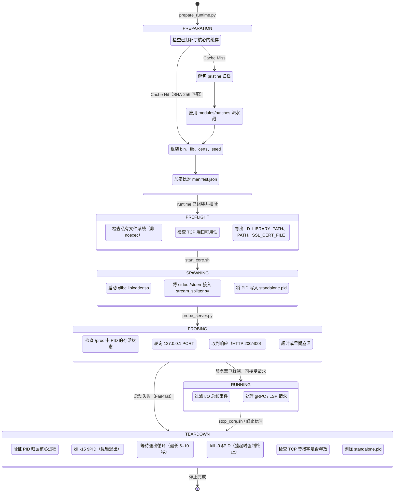

# 运行时启动与管理模块（`modules/runner`）

> **Android 平台上 Antigravity Standalone Core 运行时的架构审计与生命周期指南**

---

## 1. 架构与文件用途

`modules/runner` 模块是 Android 设备（ARM64 / `aarch64` 架构）上 Antigravity v2 standalone 运行时构建、准备、启动、健康检查与正确停止的编排器。

```
modules/runner/
├── prepare_runtime.py   # runtime 构建器与完整性校验器
├── start_core.sh        # 带 I/O 总线集成的核心后台启动脚本
├── probe_server.py      # 服务器就绪监控器（liveness/readiness probe）
├── stop_core.sh         # 优雅停止与资源清理脚本
├── test_e2e.sh          # 全周期端到端集成 E2E 测试
└── README.md            # 生命周期规范与审计结果
```

### 组件构成

| 文件 | 语言 | 用途 | 关键依赖 |
|---|---|---|---|
| `prepare_runtime.py` | Python 3 | 解包 pristine 核心、应用补丁、组装 `standalone_runtime/`、比对 `manifest.json` | `modules/core`、`modules/patches` |
| `start_core.sh` | Bash | 配置 glibc 加载器、Bionic 库，后台启动核心与 `stream_splitter.py` 流水线 | `modules/io`、`libloader.so`、`liblse_compat.so` |
| `probe_server.py` | Python 3 | 轮询本地 TCP/HTTP 端口，直到确认就绪或超时 | `urllib.request`、`socket` |
| `stop_core.sh` | Bash | 停止服务器进程：读取 PID、发送 `SIGTERM`、等待、升级为 `SIGKILL` | Linux `/proc`、`kill` |
| `test_e2e.sh` | Bash | 全周期自动运行：构建 -> 启动 -> probe -> 检查日志 -> 停止 | runner 的全部工具 |

---

## 2. 运行时生命周期（Runtime Lifecycle）

Antigravity Core 进程的生命周期由 6 个连续阶段组成：



### 各阶段详解：

1. **构建阶段（Preparation）：**
   - 由 `prepare_runtime.py` 执行。
   - 检查已打补丁二进制文件的缓存（`language_server_patched_aa7d4a1e`）。如果缓存不存在，则从 `modules/core/pristine/language_server.tar.gz` 中提取原始核心，并通过 `modules/patches/pipeline.py` 打补丁。
   - 向目标目录（`standalone_runtime`）组装以下目录：`bin/`（含 `liblanguage_server.so`、`libloader.so` 和 browser shim）、`lib/`（glibc 库）、`certs/`（`ca-certificates.crt`）、`seed/`（配置模板）。
   - 按 SHA-256 算法检查加密清单 `manifest.json`。

2. **启动前准备阶段（Pre-flight）：**
   - 检查文件系统：启动目录必须可执行（`noexec` 不可接受）。
   - 检查端口无冲突：目标端口（默认为 `45159`）必须空闲。

3. **启动与隔离阶段（Spawning）：**
   - 由 `start_core.sh` 执行。
   - 由于 Android 使用 Bionic libc（`/system/bin/linker64`），而核心二进制文件是按标准 Linux glibc（`aarch64-linux-gnu`）编译的，核心通过动态加载器 `libloader.so`（`ld-linux-aarch64.so.1`）启动：
     ```bash
     "$LOADER" --library-path "$RT/lib" [--preload "$LSE_COMPAT"] "$CORE" [参数...]
     ```
   - `stdout` 和 `stderr` 流通过管道接入拦截器 `stream_splitter.py`，后者过滤日志并将事件转发到 `EventBroker` 总线。
   - 进程 PID 写入 `standalone.pid` 文件。

4. **就绪检查阶段（Probing）：**
   - `probe_server.py` 定期轮询服务器在 `45159` 端口上的套接字。
   - 核心在 `--https_server_port 45159` 端口上监听 TLS。HTTP 连接时服务器返回 `400 Bad Request`，表示套接字处于活动状态，协议栈已准备好接受请求。

5. **运行阶段（Running）：**
   - 服务器处理 Language Server Protocol 和 gRPC 请求。
   - 事件（打开 URL、任务变更、错误提醒）由 I/O 总线处理。

6. **停止阶段（Teardown）：**
   - 由 `stop_core.sh` 执行。
   - 从 `standalone.pid` 中提取 PID。
   - 向进程发送 `SIGTERM` 信号（`kill -15`），以便正常完成后台线程、提交 SQLite 事务并刷新缓冲区。
   - 脚本等待进程退出。如果进程在超时时间内未退出，则发送 `SIGKILL`（`kill -9`）。
   - 删除 PID 文件。

---

## 3. Android 特性与限制

1. **共享存储上的 `noexec` 挂载：**
   - 外部存储（`/storage/emulated/0`、`/sdcard`）以 `noexec` 标志挂载。尝试从 `/storage/emulated/0` 运行二进制文件或加载器会返回内核错误 `EACCES (Permission denied)`。
   - **要求：** runtime 必须严格位于应用内部目录（`/data/user/0/$APP_ID/files/...`）。
2. **Glibc 与 Bionic 共存：**
   - 系统 Python 3 解释器和 bash 使用 Bionic 库（`$PREFIX/lib`）。
   - 核心使用 `$RT/lib` 中的 glibc 库。
   - `start_core.sh` 隔离环境变量，通过加载器的 `--library-path` 参数传递 glibc 库路径，避免破坏宿主二进制文件。
3. **ARMv8.1-A LSE 原子指令模拟：**
   - 在没有 LSE 硬件支持的核心上，使用拦截器 `liblse_compat.so`，它安装内核 `SIGILL` 信号（4）处理器。
4. **生命周期管理与 LowMemoryKiller（LMK）：**
   - Android 中的进程可能在内存不足时被内核强制回收。以 Foreground Service 加 Partial WakeLock 的方式运行可将此风险降至最低。

---

## 4. 审计结果与缺陷修复状态（第二轮）

在对 `modules/runner` 子系统的系统审计与重构过程中，所有发现的缺陷已全部消除：

### 问题 1：subshell 管道中的 PID 替换（已消除）
- **文件：** `start_core.sh`
- **原状：** `( CMD | python3 ... ) &; SERVER_PID=$!` 保存的是 subshell 的 PID，而非核心二进制文件的 PID。
- **实现：** 通过命名管道 FIFO（`core_stream.fifo`）启动，并启用作业控制 `set -m`。
  1. 后台拦截器 `stream_splitter.py` 从 FIFO 读取并写入 `core_output.log`（`SPLITTER_PID`）。
  2. 核心直接启动，输出写入 FIFO（`CORE_PID`），无中间 subshell。
  3. 真实核心 PID、拦截器 PID 和进程组 PGID 记录在 `standalone.pid`、`standalone.splitter_pid`、`standalone.pgid` 文件及 JSON 元数据 `standalone.json` 中。

### 问题 2：`kill -9` 前的硬编码 `sleep 1`（已消除）
- **文件：** `stop_core.sh`
- **原状：** 固定暂停 `sleep 1`，随后硬性 `kill -9`。
- **实现：** 改为每 0.1 秒循环轮询 `kill -0 "$PID"`，超时最长 5.0 秒（最多 50 次迭代）。
  - 如果核心在零点几秒内正常退出，停止立即完成，无多余等待。
  - 仅当进程挂起超过 5 秒时，才发送升级信号 `SIGKILL`（`kill -9`）。

### 问题 3：PID 重用风险（PID Recycling Hazard）（已消除）
- **文件：** `stop_core.sh`
- **原状：** 不验证归属就盲目调用 `kill -0 "$PID"`。
- **实现：** 发送任何信号前先检查 `/proc/$PID/cmdline` 的内容。仅当进程签名确实包含 `language_server` 时才发送信号。不匹配时输出警告，不触碰他人进程。

### 问题 4：缺少端口占用 pre-flight 检查（已消除）
- **文件：** `start_core.sh`
- **原状：** 尝试绑定已被占用的端口会导致隐藏错误并掩盖状态。
- **实现：**
  1. 内置通过 `/dev/tcp/127.0.0.1/$PORT` 套接字连接检查端口可用性。
  2. 添加了严格的服务端口保护：端口 45167 和 45168 保留给 Antigravity IDE 主运行时，在这些端口上启动 standalone 核心会被错误阻止。
  3. 发现 45159 端口被占用时，脚本先尝试通过 `stop_core.sh` 正确停止上一个实例，然后扫描 `/proc` 查找 standalone 核心的僵尸进程（`antigravity-app-standalone` + `language_server` + `$PORT`）并终止它们。
  4. 如果端口在 2 秒内未释放，启动会以信息明确的错误中断。

### 问题 5：`prepare_runtime.py` 中的缓存校验（已消除）
- **文件：** `prepare_runtime.py`
- **原状：** 未检查 `TARGET_SHA`，任何名称合适的损坏文件都会被盲目复制。
- **实现：** 添加了对缓存核心二进制文件的分块 SHA-256 检查（`ec217e58...`）。哈希不匹配时缓存视为无效，核心重新解包并打补丁。

### 问题 6：服务器早期崩溃时 `probe_server.py` 挂起（已消除）
- **文件：** `probe_server.py`
- **原状：** 即使核心进程在第一秒就崩溃，也会阻塞等待 HTTP 响应 40 秒。
- **实现：** 实现 fail-fast 机制：每次轮询迭代都通过 `os.kill(target_pid, 0)` 检查进程存活状态。核心早期崩溃时，`probe_server.py` 立即以返回码 1 中断并输出错误。

### 问题 7：`test_e2e.sh` 中缺少异常终止处理器（已消除）
- **文件：** `test_e2e.sh`
- **原状：** 任何步骤出错时，服务器进程都会滞留在系统中。
- **实现：** 设置处理器 `trap 'bash "$SCRIPT_DIR/stop_core.sh" "$RT"' EXIT INT TERM`，在成功完成停止步骤后解除。

### 问题 8：APP_ID 动态确定（已消除）
- **文件：** `start_core.sh`、`stop_core.sh`、`test_e2e.sh`
- **实现：** `APP_ID`（`io.github.ziyekaixuan.antigravity` vs `io.github.ziyekaixuan.antigravity.dev`）根据 `AGY_APPLICATION_ID` 变量、`$HOME` 中的正则表达式（`/data/user/0/<app_id>`）或检查应用目录是否存在来动态确定。

---

## 5. 监督者架构模型

当前 `modules/runner` 实现采用可靠的模型，通过 FIFO 与进程组进行协调：

```
[start_core.sh]
       │
       ├──> set -m（启用作业控制与 PGID）
       │       │
       │       ├──> stream_splitter.py (Python) <──stdin── FIFO (/data/user/0/.../core_stream.fifo)
       │       │       └──> core_output.log（带过滤与 EventBroker 总线）
       │       │
       │       └──> language_server (Glibc via libloader.so) ──stdout/err──> FIFO
       │               └──> 真实 PID 写入 standalone.pid
       │               └──> PGID 写入 standalone.pgid
       │
       └──> probe_server.py（端口 45159 的 Fail-Fast 监控与 os.kill(pid, 0)）
       │
       └──> stop_core.sh（检查 cmdline、kill -15 -$PGID、0.1s..5s 轮询、回退 kill -9）
```

### 稳定性关键保证：
1. **组信号（`-$PGID`）：** 停止保证覆盖核心、流拦截器及任何子 worker / sidecar。
2. **即时 Fail-Fast：** 核心崩溃时 `probe_server.py` 不等待超时。
3. **Android 系统进程安全：** PID recycling 保护可防止误杀系统服务。
4. **无冲突启动：** Pre-flight 校验在启动前清理占用 45159 端口的僵尸进程。

---

## 6. 测试与校验命令

```bash
# 1. 运行 runtime 端到端 E2E 测试：
bash modules/runner/test_e2e.sh

# 2. 运行 Antigravity v2 全部模块的总测试：
bash test_all_modules.sh

# 3. 手动隔离运行各组件：
# 准备 runtime：
python3 modules/runner/prepare_runtime.py /data/user/0/io.github.ziyekaixuan.antigravity.dev/files/standalone_runtime

# 在指定端口上启动核心：
bash modules/runner/start_core.sh /data/user/0/io.github.ziyekaixuan.antigravity.dev/files/standalone_runtime 45159

# 检查可用性（超时 10 秒）：
python3 modules/runner/probe_server.py 45159 10

# 正确停止：
bash modules/runner/stop_core.sh /data/user/0/io.github.ziyekaixuan.antigravity.dev/files/standalone_runtime
```
