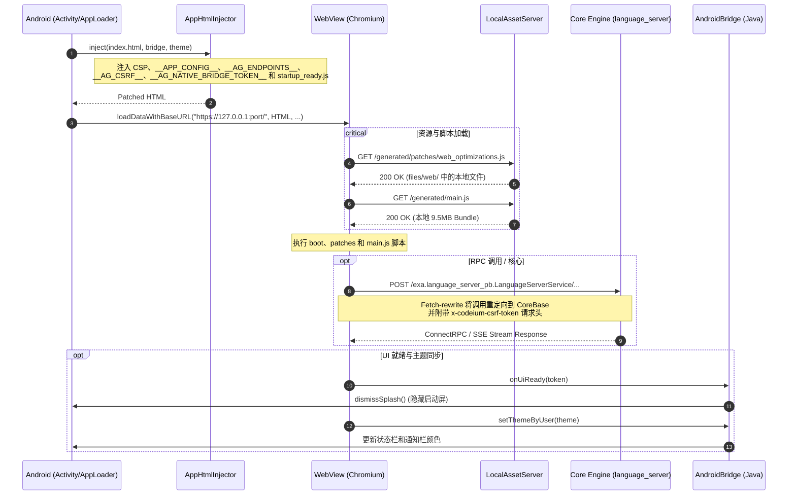

# Antigravity Web 界面：`web/`

> 单页应用（基于 React 的 SPA），运行在隔离的 Android WebView 中，通过 loopback HTTPS 和原生 Java 桥（`AndroidBridge`）与本地 Go/C++ 核心（`language_server`）交互。

---

## 1. 架构概览（Architecture Overview）

Antigravity 的 Web 层是一个专用的 UI 前端，打包在应用资源中，并针对 Android（ARM64）触摸屏进行了优化。它不通过经典的 `file:///android_asset/` 方案加载（该方案会阻止现代浏览器功能和 ConnectRPC 工作），而是通过 `loadDataWithBaseURL` 挂载到 `WebView`，使用 loopback 服务器的可信源 `https://127.0.0.1:<port>/`。

### 交互架构图



---

## 2. 文件与目录结构

```
web/
├── build.sh                      # 片段构建器与补丁器的 Bash 编排脚本
├── src.manifest                  # web/generated/** 构建的声明式清单
├── patch_main.py                 # 上游 main.js 的补丁器（桌面模式 + 单色 Eza）
├── index.html                    # 应用宿主的根 HTML 模板
├── main.js                       # 原始（上游）经过混淆的 React UI Bundle（约 9.9 MB）
├── jetbox.css                    # 特定控件与终端的样式
├── compiled_tailwind.css         # 基础编译版 Tailwind CSS Bundle
├── prism_bundle.js               # PrismJS 语法高亮 Bundle（defer）
├── diff_worker.js                # 后台计算字符串差异的 Web Worker
├── audio_processor.js            # 16 kHz 流式音频的 AudioWorkletProcessor
├── antigravity-icon.png          # 应用图标
├── google_signin.svg             # 登录按钮的矢量资源
├── symbols-icons/                # Material Symbols 图标本地缓存
├── workers/                      # 与 PDF.js 集成的模块
│   ├── pdf.min.mjs               # PDF.js 核心库
│   ├── pdf.worker.mjs            # PDF 解析 Worker
│   └── pdfjs_loader.mjs          # Closure compiler 与 ESM PDF.js 之间的桥
├── generated/                    # 构建产物目录（由 build.sh 生成）
│   ├── main.js                   # 经过补丁的工作应用 Bundle
│   ├── bridge.core.js            # 桥核心、Polyfill 与 fetch 重写器
│   ├── boot/                     # 早期初始化脚本（<head>）
│   │   ├── custom-elements-guard.js
│   │   └── theme-bootstrap.js
│   └── patches/                  # 移动端补丁与适配器
│       ├── web_optimizations.js
│       ├── touch_model_menu.js
│       ├── theme_sync.js
│       └── startup_ready.js
├── src/                          # Bundle 片段的模块化源码
│   ├── boot/                     # 早期启动片段
│   ├── core/                     # 桥核心片段（namespace、csrf、fetch 等）
│   └── patches/                  # 功能补丁片段
└── tests/
    └── selftest.sh               # 构建与源码完整性检查测试
```

---

## 3. Bundle 构建流水线（Bundling Pipeline）

Web 层的构建由工具 [`build.sh`](build.sh) 根据清单 [`src.manifest`](src.manifest) 执行。流水线设计保证**上游 `main.js` 文件不可变**：所有修改仅应用于 `web/generated/main.js` 中的副本。

### `src.manifest` 语法
- `bundle iife <path>` — 声明一个 Bundle，包装在隔离的 IIFE `(function(){ ... })();` 中。如果 Bundle 的源片段已经有自己的顶层闭包，`build.sh` 会自动跳过重复包装，防止出现嵌套的 `(function(){(function(){...})()})();`。
- `bundle <path>` — 声明一个直接拼接、不加闭包的 Bundle。
- `src/<path>` — 向当前打开的 Bundle 添加代码片段。
- 以 `#` 和 `;` 开头的行视为注释。

### 生成的 Bundle

| Bundle（`web/generated/...`） | 模式 | 大小 | 用途 |
|---|---|---|---|
| **`boot/custom-elements-guard.js`** | IIFE | ~514 B | 防止在 overlay Bundle 中重复注册 Custom Elements 时崩溃。 |
| **`boot/theme-bootstrap.js`** | IIFE | ~1.3 KB | 在首次渲染前立即应用 `light`/`dark`，防止屏幕闪烁。 |
| **`bridge.core.js`** | IIFE | ~12 KB | `window.process` Polyfill、配置、CSRF、端点发现和 `fetch` 拦截器。 |
| **`patches/web_optimizations.js`** | IIFE | ~2.2 KB | 消除 300 毫秒点按延迟、打开 IME 时固定 `--agy-vvh` 高度、GPU 合成。 |
| **`patches/touch_model_menu.js`** | IIFE | ~6.7 KB | 将 Base UI 的模型选择 hover 菜单适配为触摸输入。 |
| **`patches/theme_sync.js`** | IIFE | ~4.7 KB | 用 MutationObserver 监听 `<html>`/`<body>` 的类变化，并将主题切换传递给原生 Android。 |
| **`patches/startup_ready.js`** | IIFE | ~4.7 KB | 检测首次有效 DOM 渲染，并为 `AndroidBridge` 拦截 JS 错误。 |
| **`main.js`** | Raw + Patch | ~9.5 MB | 经 `patch_main.py` 脚本打补丁后的 React UI 工作 Bundle。 |

### 有效性检查（Verification）
构建后，`build.sh` 会用 V8 静态语法分析器（`node --check`）检查每个生成的文件。如果环境中没有安装 Node.js，则跳过检查并给出提示性警告。

---

## 4. 主 Bundle 补丁（`patch_main.py`）

脚本 [`patch_main.py`](patch_main.py) 对编译后经过混淆的 `main.js` Bundle 执行动态修改：

1. **幂等性**：补丁前检查是否存在 `"Desktop Mode"` 或 `"ag_desktop_mode"` 标记。如果已存在，则跳过重复应用。
2. **注入桌面模式开关（Desktop Mode Toggle）**：
   - 找到 Appearance 组件钩子的签名：
     ```python
     hook_pattern = re.compile(r'(var\s+[A-Za-z0-9_$]+=[A-Za-z0-9_$]+!==3,\s*[A-Za-z0-9_$]+=[A-Za-z0-9_$]+!==2,\s*[A-Za-z0-9_$]+=[A-Za-z0-9_$]+=>\s*[A-Za-z0-9_$]+=>\{.*?\};)')
     ```
   - 注入 React 钩子 `useState` 和 `useCallback`，将状态与 `window.Android.isDesktopMode()` 和 `localStorage.getItem('ag_desktop_mode')` 绑定。
   - 找到 `{label:"Theme"}` 区块的 `createElement` 调用，并在其后立即注入带开关（`Switch`）的桌面模式设置项。
3. **Eza Logo 单色化**：
   - 上游 Antigravity Logo 包含硬编码的多色 SVG（`mask0_6153_71`）。
   - 补丁器将 `var Eza=...` 组件体替换为单色扁平 SVG，使用 CSS 令牌 `text-[#9AA0A6]`（深色主题）和 `text-[#5F6368]`（浅色主题）。

---

## 5. 与原生 Android 的交互（`AndroidBridge`）

Web 应用运行在 WebView 中，对象 `Android`（以及别名 `window.AndroidBridge`）通过 `addJavascriptInterface` 注册。

### 加载时注入（`AppHtmlInjector`）
在将标记传递给 WebView 引擎之前，Java 类 `AppHtmlInjector` 会向 `<head>` 注入：
- **严格的内容安全策略（CSP）**：禁止不安全的外部框架和对象，限制 `worker-src 'self' blob:`。
- **全局配置参数**：
  - `window.__APP_CONFIG__` — 环境 JSON 参数（版本、平台、工作区路径）。
  - `window.__AG_ENDPOINTS__` — 核心服务器地址（`core`、`core_http`、`enginePort`）。
  - `window.__AG_CSRF__` — 用于在 `language_server` 中鉴权的加密 CSRF 令牌。
  - `window.__AG_HOST_THEME__` / `window.__AG_RESOLVED_THEME__` — 宿主初始主题（`dark` / `light` / `system`）。
  - `window.__AG_NATIVE_BRIDGE_TOKEN__` — 32 字节一次性加密令牌，用于鉴权特权调用（重置启动屏、保存 Blob）。
- **就绪信号脚本**：`<script src="./generated/patches/startup_ready.js"></script>`。

### 桥接口 `window.Android`

| 方法 | 签名 | 用途 |
|---|---|---|
| `onUiReady` | `(token: string) => void` | `startup_ready.js` 脚本在首次真实 DOM 渲染时调用，用于隐藏原生启动屏。 |
| `onUiError` | `(token: string, message: string) => void` | 将关键的致命 JS 错误传递给原生 logcat 和错误界面。 |
| `setThemeByUser`| `(theme: string) => boolean` | 传递用户选择的主题（`light`/`dark`），用于更新 Android 系统栏的颜色。 |
| `onVisualThemeChanged` | `(theme: string) => void` | 通知当前 CSS 样式已切换。 |
| `getTheme` | `() => string` | 返回当前设备系统主题。 |
| `isDesktopMode` | `() => boolean` | 检查是否启用了宽屏桌面 Viewport 模式。 |
| `setDesktopMode`| `(enabled: boolean) => void` | 在移动端和桌面模式之间动态切换 WebView 的 User-Agent 和 Viewport。 |
| `openDirectoryPicker` | `() => void` | 启动系统文件夹选择对话框（SAF Document Tree）以打开项目。 |
| `saveBlob` | `(token, base64, filename, mime) => void` | 安全地将 Web 界面生成的 Blob 保存到 `Downloads` 存储中。 |

---

## 6. Web 层子系统

### 6.1. 主题子系统（Theme Engine）
1. **早期阶段（`theme-bootstrap.js`）**：在 `<head>` 中同步执行。读取 `?hostTheme=` 或 `__AG_HOST_THEME__`。立即给 `document.documentElement` 设置 `dark`/`light` 类并指定 `style.colorScheme`。消除深色主题启动时的白屏闪烁。
2. **运行中同步（`theme_sync.js`）**：
   - `MutationObserver` 监听 `<html>` 和 `<body>` 上 `class` 属性的变化。
   - `window.addEventListener('storage')` 监听器跟踪其他标签页中的主题切换。
   - `matchMedia('(prefers-color-scheme: dark)')` 监听器响应系统日夜切换。
   - `notify()` 方法更新原生 Android 通知栏和面板。

### 6.2. 移动端优化（Mobile & Touch Optimizations）
- **`web_optimizations.js`**：
  - 按钮、链接和输入框上的 `touch-action: manipulation` 关闭浏览器 300 毫秒双击延迟。
  - `visualViewport.addEventListener('resize')` 动态以像素为单位重新计算变量 `--agy-vvh`，防止 IME 键盘弹出时聊天输入框抖动。
  - 有选择地使用 `transform: translateZ(0)`，仅对关键滚动容器（`chat-container`、`.scrollable`）强制启用 GPU 图层，防止在 ARM Mali 芯片上耗尽显存和 RenderThread 卡顿。
- **`touch_model_menu.js`**：
  - Antigravity 的模型选择下拉列表在 Base UI 库中仅通过鼠标 hover 事件打开思考级别菜单（Low / Medium / High）。
  - 在触摸屏上，点按会导致直接选中默认模型而不展开设置。
  - 补丁在捕获阶段拦截 `pointerdown`/`click`，阻止事件并模拟合成指针事件链（`pointerover`、`pointerenter`、`pointermove`），随后以 70 毫秒和 260 毫秒的延迟发送 `KeyboardEvent('ArrowRight')`，保证移动端子菜单打开。

### 6.3. 核心桥与传输（Core Transport & Fetch Rewrite）
- **`bridge.core.js`**：
  - 创建 `window.process` 桩（Linux / ARM64 / renderer），带有标准的 `cwd()` 和 `nextTick()` 方法。
  - 重写 `window.fetch`。所有指向 ConnectRPC 标记（`exa.language_server_pb.`、`exa.host_bridge_pb.`、`/exa.`）的请求都被重写到核心目标源 `https://127.0.0.1:<enginePort>`。
  - 自动注入 CSRF 请求头 `x-codeium-csrf-token` 和参数 `csrf_token`。
  - 包含重试逻辑 `fetchWithStartupRetry`（最多 30 次尝试，间隔 120 毫秒），防止前端启动早于核心 TLS 套接字完成绑定时首个请求失败。

### 6.4. Worker 与音频处理
- **PDF 流水线（`workers/`）**：在 `pdf.worker.mjs` Worker 中隔离处理文档，不阻塞主 UI 线程。
- **差异计算（`diff_worker.js`）**：行变更统计计算（Myers 算法 $O(ND)$，带相同前后缀截断）移至 Web Worker。
- **语音 / 音频处理器（`audio_processor.js`）**：注册为名为 `audio-streaming-processor` 的 `AudioWorkletProcessor`。将麦克风音频流实时下采样到 16 kHz PCM（`Int16Array`），发送给多模态模型。

---

## 7. 审计结果：架构补丁与建议

在 Web 层审计过程中，发现了一系列架构细节、瓶颈和补丁：

| 问题 / 补丁 | 位置 | 风险描述 | 修复建议 |
|---|---|---|---|
| **APK 流水线中缺少 Web 层自动构建** | `modules/builder/05_stage_assets.py` | 脚本 `05_stage_assets.py` 会检查并构建 `env`，但对于 `web/` 只是复制现有的 `web/generated/`。如果开发者修改了 `web/src/**` 却没有手动运行 `web/build.sh`，APK 中就会包含过时的 Bundle。 | **[已修复]** 在 `05_stage_assets.py` 中添加了在资源分阶段前自动调用 `bash web/build.sh`。 |
| **`src.manifest` 泄漏到最终发布 APK** | `modules/builder/05_stage_assets.py` | 忽略文件列表 `web_ignore` 中缺少 `src.manifest`，导致构建器源清单进入了生产 APK 的资源。 | **[已修复]** `"src.manifest"` 已加入 `web_ignore` 排除元组。 |
| **脆弱的 `main.js` 正则补丁** | `web/patch_main.py` | 补丁器依赖 React 混淆变量的精确签名（`var C=g!==3,D=g!==2...`），并包含硬编码的备用组件名（`item_comp="v3"`、`switch_comp="dX"`）。Bundle 版本变更时可能导致注入失败或 `ReferenceError`。 | 通过 AST 解析器实现语法验证，或在 CI 中添加严格的接口存在性检查测试。 |
| **多余的双重 IIFE 包装** | `web/src.manifest`、`src/boot/theme-bootstrap.js` | 源文件 `theme-bootstrap.js` 已有自己的闭包 `(function(){...})()`，而清单中又声明为 `bundle iife`。结果生成了双重嵌套 IIFE。 | **[已修复]** 在 `web/build.sh` 中添加了 `is_already_iife` 检查，防止对已闭合的片段重复包装。 |
| **对 Android 上 `/tmp` 的依赖** | `web/build.sh`（第 28 行） | 调用 `mktemp "${TMPDIR:-/tmp}/..."` 在 Android 上会失败，因为环境中没有 `$TMPDIR`，而系统中也不存在 `/tmp` 目录。 | **[已修复]** 替换为可移植且安全的路径 `${TMPDIR:-${HOME:-.}/.tmp}`，并自动创建目录。 |
| **硬编码的备用 CSRF** | `web/src/core/csrf.js`（第 13 行） | 如果令牌未通过 `__AG_CSRF__` 传递且 DOM 中也没有，则使用常量 `'agy-standalone-token'`。 | 在初始化时生成随机的 UUID/Hex 备用令牌，替代静态常量。 |
| **发现机制中端口方案不一致** | `web/src/core/endpoints.js`（第 50 行） | 解析 URL 参数 `?port=` 时设置 `ENDPOINTS.core_http = 'http://127.0.0.1:' + port;`，但核心仅通过 HTTPS 工作。 | 将方案改为 `https://127.0.0.1:`，与 TLS 传输保持一致。 |
| **通过延迟模拟触摸事件** | `web/src/patches/touch_model_menu/` | 模型菜单的展开依赖 `setTimeout(..., 70)` 和 `setTimeout(..., 260)` 序列。CPU 负载较高时延迟可能来不及触发。 | 使用 MutationObserver 或焦点变化事件来确认子菜单已打开。 |

---

## 8. 检查与测试（Verification）

要检查 Web 层的完整性与可构建性，请运行自诊断测试：

```bash
bash web/tests/selftest.sh
```

测试执行以下步骤：
1. 创建 `web/` 目录的隔离临时副本。
2. 记录原始 `main.js` 的 SHA-256 校验和。
3. 运行构建 `web/build.sh` 和补丁器 `patch_main.py`。
4. 检查原始 `main.js` 保持不变。
5. 检查所有文件已生成且 `index.html` 中的路径有效。
6. 验证生成的 Bundle 中没有重复的 IIFE 包装。
